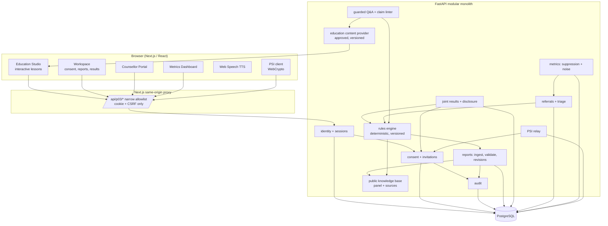
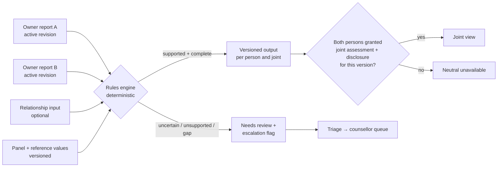
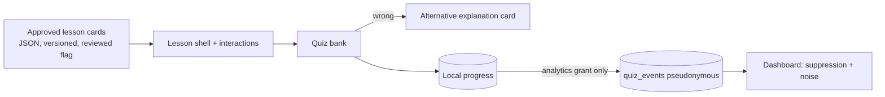
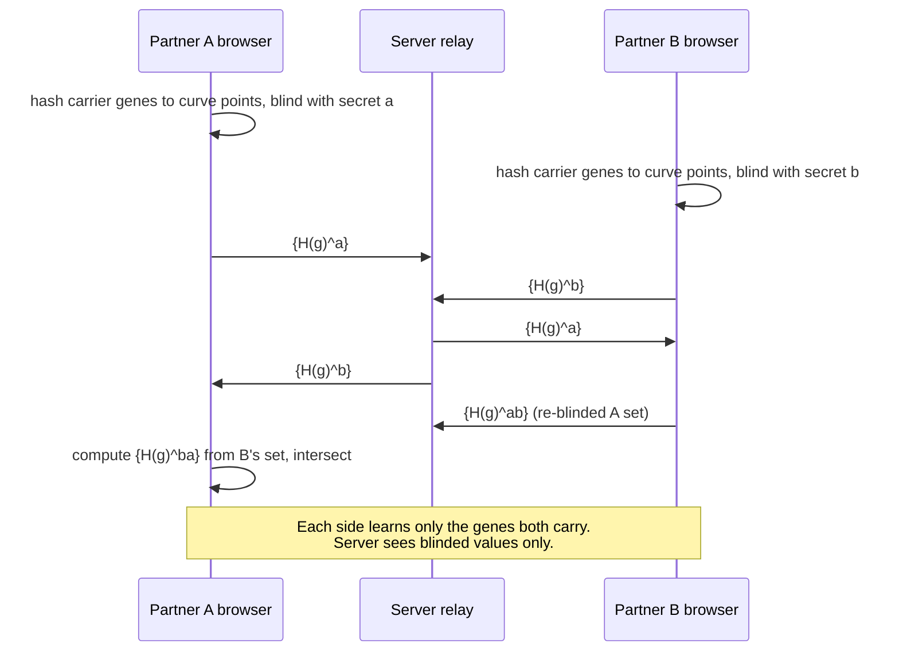

# Generisk (Amanah Genetics) — Complete Solution Document

**Challenge:** Future Health Digital Innovation Challenge — *Understanding and Reducing Inherited Disease Risk* (consanguinity, Abu Dhabi context)
**Repo:** https://github.com/AryanMedigeri08/Generisk
**Document date:** 2026-11-16 · **Status:** master plan for the hackathon build (supersedes older phase naming where they conflict; all safety labels remain)
**Constraint:** fully software-based, built on publicly available data, synthetic people only.

> **Synthetic demonstration — not for clinical use.** No real patient data, no real laboratory, no diagnosis, no marriage recommendation.

---

## 1. Problem and objective

Abu Dhabi has invested in population genomics and pre-marital genetic screening. Screening only helps if people can understand a carrier result or couple-level risk, reach qualified counselling, and decide in line with their own values. Genetic information is probabilistic and shared across families, so misunderstanding can cause anxiety, stigma, family tension or false certainty. Consanguineous marriage is a long-standing cultural practice, so the response must support informed choice, not judgement or coercion.

**Objective:** help individuals, families and health services understand inherited disease risk earlier and act on it, respecting cultural values and keeping personal and genetic information private.

### The six things the solution must do (from the brief)

| # | Requirement | Our answer (summary) |
|---|---|---|
| 1 | **Risk explanation** in plain, non-stigmatizing language, including uncertainty and risk ≠ diagnosis | Deterministic risk engine + interactive education studio (Gene Keys, Next-100-Families, family-tree slider, negative-result bar) |
| 2 | **Informed, values-sensitive choices** without directing or coercing | Options screen with equal weight, no default, "subject to UAE rules and provider eligibility" |
| 3 | **Qualified human counselling** for complex/high-impact/ambiguous findings; clear boundary between education, decision support and clinical advice | Triage rules → counsellor queue; engine and AI never give clinical advice |
| 4 | **Privacy-preserving family workflows**: explicit consent, role-based access, data minimization, auditable sharing, individual control | Independent per-person consent (built), append-only audit (built), private set intersection for couple matching (planned) |
| 5 | **Safe linkage to services**: traceable path from result to counselling, confirmatory assessment, reproductive-genomics services | Referral state machine with timeline (simulated providers, labelled) |
| 6 | **Measurable comprehension and access** across languages and literacy levels; no "cancelled marriage" metric | Teach-back quiz + privacy-preserving equity dashboard |

---

## 2. Positioning and uniqueness

### What exists today

- **Abu Dhabi's programme.** The Department of Health integrated genetic testing into pre-marital screening for Emirati couples. Public statements describe a panel of 570 genes covering 840+ autosomal recessive disorders, counselling with healthcare professionals and genetic counsellors, and results in roughly 14 days. DoH-reported pilot figures use "compatibility" wording (about 86% compatible, 14% needing additional intervention). We found no public sign of a patient-controlled digital layer around it.
- **Igentify Digital Genetic Assistant (commercial).** Couple-based digital carrier-screening workflow: digital intake, automated personalised video explanations for low-risk couples, counsellor dashboard with pedigree editor, high-risk couples routed to face-to-face counselling. In a 225-couple study it reduced face-to-face counselling interactions by about 69% (npj Digital Medicine, 2025, doi:10.1038/s41746-025-01573-7). It is closed, tied to specific lab tests, and uses high/low risk assignment.

*(Based on a brief search; consumer-genomics apps and other lab portals were not exhaustively reviewed. Say "we found no…" rather than "nobody does…".)*

### What Generisk does differently

| Area | Typical today | Generisk |
|---|---|---|
| Consent | Couple treated as one unit | Each partner consents independently, per purpose (processing / joint assessment / disclosure); withdrawal blocks later access; partner sees only neutral "unavailable" — **built** |
| Couple matching | Results compared platform-side | Private set intersection: partners learn only shared carrier genes — *planned* |
| Consanguinity | Test-result-centred | Pre-test and post-test risk that uses relationship (inbreeding coefficient F) and public allele frequency — *planned* |
| Framing | High/low risk, "compatible" | Descriptive outcomes, natural frequencies, risk ≠ diagnosis, no default choice; triage prioritises counsellor time but never labels the couple — *planned* |
| Language/literacy | Aggregate comprehension numbers | Arabic-first, plain-language, audio, teach-back, results split by language and literacy level — *planned* |
| Metrics | Efficiency, preference | Uptake, time-to-referral, privacy incidents, equity gaps; small-cell suppression and noise; explicit "not measured: cancelled marriages" — *planned* |
| AI | Varies | LLM only rephrases/answers from approved content; claim linter blocks any number not produced by the rules engine — *planned* |
| Openness | Closed, lab-specific | Open, public-data panel with visible provenance; every number traceable — *planned* |

**One-line pitch:** *Generisk helps couples understand inherited risk in their own language, keeps each person in control of their own information, and never tells anyone what to decide.*

---

## 3. Users and personas

| Persona | Goal | Boundary |
|---|---|---|
| **Individual / partner** | Learn first, then understand their own result privately; choose whether to share with a partner | Never sees partner data without that partner's separate grant |
| **Couple** | Understand the combined picture and options | Joint view only when both grant disclosure for that output version |
| **Genetic counsellor (accredited)** | Review prioritised cases, explain, refer | Access only with assignment + current counselling-review purpose |
| **Support/admin** | Operate accounts and service | No clinical detail by default |
| **Content/safety reviewer** | Approve education content and wording | Separate from authoring (future real service) |
| **Health system / programme lead** | See access, comprehension, equity | Aggregate, suppressed metrics only |

---

## 4. End-to-end journey (couple)

1. **Learn first (no account data needed):** interactive lessons in Arabic or English, with read-aloud. Teach-back quiz.
2. **Sign in and consent:** each partner signs in separately; grants *processing*; partner invitation is recipient-bound and is **not** consent.
3. **Result arrives** (synthetic fixture standing in for a screening lab report): validated, versioned, provenance recorded. Only the owner can see it.
4. **Personal explanation:** the engine produces a versioned, deterministic explanation (never AI-generated numbers). The person sees it privately.
5. **Optional sharing:** each person separately grants *joint assessment* and *disclosure* of a specific output version. Optional private carrier-gene matching (PSI).
6. **Joint view:** non-binary, plain-language description of the combined picture and uncertainty.
7. **Options:** equal-weight pathways (counselling, confirmatory testing, reproductive-genomics options, continue as planned), labelled by availability.
8. **Escalation:** high-impact or ambiguous findings produce a "talk to a counsellor" action that creates a referral.
9. **Counselling and follow-through:** counsellor queue, case brief, referral timeline (simulated providers).
10. **Measurement:** comprehension, uptake and time-to-referral feed an aggregate dashboard.

---

## 5. Feature catalogue and status

Status: **Built** (in repo), **Planned Pxx** (see §18).

| Feature | Objective | Status |
|---|---|---|
| Local fictional identity, sessions, CSRF, rate limits | 4 | Built (P03) |
| Independent per-person consent: processing / joint assessment / reviewed-output disclosure, versioned, with withdrawal | 4 | Built (P03) |
| Recipient-bound invitations (not consent) | 4 | Built (P03) |
| Append-only transactional audit; audit failure rolls back action | 4 | Built (P03) |
| Synthetic report ingestion, validation, immutable revisions, provenance, amendment invalidates dependent consent/output | 4, 5 | Built (P04) — fake markers only |
| Real-gene demo panel from public data + source attribution | 1 | Planned P05 |
| Report schema v2 (gene-level) + fixtures | 1 | Planned P05 |
| Deterministic risk engine (couple, one-carrier, uncertain, coverage-gap, residual risk, consanguinity) | 1, 3 | Planned P06 |
| Education studio (interactive React lessons) | 1 | Planned P07 |
| Arabic/English, RTL, read-aloud (TTS), reading-level aids | 1, 6 | Planned P08 |
| Teach-back quiz + comprehension events | 6 | Planned P08 |
| Joint result view + "what my partner will see" preview | 1, 4 | Planned P09 |
| Options screen + referral intake | 2, 3, 5 | Planned P09 |
| Counsellor portal, triage, referral timeline | 3, 5 | Planned P10 |
| Metrics and equity dashboard | 6 | Planned P11 |
| Private set intersection couple matching | 4 | Planned P12 |
| Guarded Q&A with claim linter | 1, 3 | Planned P12 |
| Access receipt (user-readable audit) | 4 | Planned P12 |
| Anonymous family letter (cascade screening) | 4 | Planned P12 |
| Hosted demo, video, deck | — | Planned P13 |

---

## 6. System architecture

### 6.1 Stack

- **Frontend:** Next.js + TypeScript + React, accessible components, logical CSS (RTL-ready), Vitest, Playwright + axe.
- **Backend:** Python 3.12, FastAPI, Pydantic, SQLAlchemy, Alembic migrations (0001–0003 exist).
- **Database:** PostgreSQL 17 (advisory-lock serialized transactions, append-only triggers).
- **Packaging/CI:** Docker Compose, GitHub Actions (api, web, compose-smoke).
- **Pattern:** modular monolith; extract nothing until needed.

### 6.2 Component view



### 6.3 Module responsibilities (hard boundaries)

| Module | Owns | Must never |
|---|---|---|
| identity/consent/audit (P03) | users, sessions, ownership, grants, history, audit | Treat an invitation or a role as consent |
| reports (P04, extended P05) | immutable source, validation, versions, provenance | Accept arbitrary uploads; interpret findings |
| knowledge base (P05) | gene/condition panel, source attribution, public reference values | Hold personal data |
| rules engine (P06) | deterministic, versioned risk output from supported inputs | Use an LLM; guess when inputs are unsupported/uncertain; emit marriage advice |
| education provider (P07/P08) | approved lesson cards, quiz bank, i18n, review status | Contain personal data; serve unreviewed content as approved |
| joint results (P09) | release of output versions gated by both parties' grants | Release on invitation alone; leak the reason for a refusal |
| referrals/triage (P09/P10) | referral state machine, counsellor queue | Mark "booked" without evidence or explicit simulation |
| metrics (P11) | aggregate KPIs with suppression and noise | Expose raw or identifying records; count marriage outcomes |
| Q&A (P12) | answer from approved cards with citation | Produce numbers not from the engine; give personal advice |

### 6.4 Defence-in-depth already present (P03/P04)

Argon2id password hashing; opaque, hashed, revocable sessions; CSRF; rate buckets; default-deny routes; cross-user denial that does not enumerate; per-purpose versioned consent with history that cannot be updated or deleted; serialized transaction boundary with audit inside the same transaction; idempotency keys; invitation tokens bound to recipient, expiring, replay-safe; immutable report sources with hash and active-head pointer; correction invalidates dependent grants and outputs.

---

## 7. Data model

### 7.1 Existing tables

- **P02:** demo templates.
- **P03 (11 tables):** users, sessions, ownership, assignments, joint requests, invitations, consents, consent history, idempotency, rate buckets, audit.
- **P04:** `p04_reports`, `p04_revisions`, `p04_import_outcomes`.

### 7.2 Planned (additive migrations)

| Table / store | Purpose | Phase |
|---|---|---|
| Panel (JSON packaged, optional `kb_gene`/`kb_condition` mirror) | Genes, conditions, reference values, source ids; loaded at start, versioned by hash | P05 |
| `risk_assessments` (+ inputs) | Versioned engine output bound to exact report revision ids, panel version, rules version, relationship input | P06 |
| `relationship_inputs` | Minimal self-declared relationship category (e.g. unrelated / second cousins / first cousins / double first cousins) → F; owner-only | P06 |
| `education_progress` | Lesson/quiz progress, local-first; server copy only with analytics grant | P08 |
| `quiz_events` | Pseudonymous, analytics-consented, language + literacy tier tagged | P08/P11 |
| `referrals`, `referral_events` | State machine and timeline | P09/P10 |
| `psi_sessions` | Ephemeral relay state (blinded values only) | P12 |

### 7.3 New consent purposes (extend P03)

Existing: **processing**, **joint assessment**, **reviewed-output disclosure**.
Planned: **counsellor-review** (resolves the open "professional report purpose": counsellors see nothing without it plus assignment), **analytics** (opt-in, for metrics).

---

## 8. Data flows

### 8.1 Report import and validation

```mermaid
sequenceDiagram
  participant U as Owner (browser)
  participant A as API
  participant K as Knowledge base (panel)
  participant D as PostgreSQL
  U->>A: choose allowlisted synthetic fixture (session+CSRF)
  A->>A: require ownership + current processing grant
  A->>A: structural validation (bounds, enums, hash, linkage)
  A->>K: check gene symbols against panel version
  A->>D: BEGIN; store original + validated JSON + hash; set active head;<br/>supersede dependent consent/outputs; write audit; COMMIT
  A-->>U: accepted / review_required / unsupported / malformed (minimized)
```

### 8.2 Risk computation and release



Rules: inputs are exact revisions; any report change, consent change, panel change or rules change produces a new output version and invalidates dependent disclosure.

### 8.3 Consent and withdrawal

Each person grants/withdraws independently. Withdrawal blocks all authorizations ordered after its commit; prior viewing cannot be undone and the UI says so. A neutral "unavailable" response is identical for refusal, withdrawal and non-enrolment.

### 8.4 Education and teach-back



Generic Mendelian demos (1/4, 1/2, 1/4) run client-side with fixed constants. Any gene-specific or personal number comes from the server engine.

### 8.5 Referral

Engine escalation flag → person sees "talk to a counsellor" → referral created (needs counsellor-review grant to share a minimal case brief) → triage priority → counsellor queue → states: requested → accepted → counselling scheduled (simulated) → confirmatory assessment requested (simulated) → reproductive-genomics referral (simulated) → closed. Every transition is audited; "booked" appears only for explicitly simulated bookings.

### 8.6 Private set intersection (couple matching)



Guards: both must hold current joint-assessment grants; set size bound to the person's active report carrier count (inputs committed to the report hash so nobody can submit "all genes" to probe the other's set); demo uses a small prime-order group via WebCrypto-compatible library; documented as a prototype, not audited cryptography.

### 8.7 Guarded Q&A

Question → classify (education vs personal/clinical) → personal/clinical → refuse and offer counsellor → education → retrieve from approved cards only (no personal data in prompts) → LLM rewrites with citation → **claim linter** rejects any number, probability or recommendation not present in approved cards or engine output → fallback "I don't have an approved answer; please speak with a counsellor."

---

## 9. Data sources (public)

> Always verify the current licence/terms before ingesting. Record for each used item: source id, URL, retrieval date, field/table, licence note, and whether the value is **sourced** or **illustrative**.

| Source | Use | Notes |
|---|---|---|
| **ClinVar (NCBI)** | Gene–condition pathogenicity statements and review status at gene level (for choosing panel genes) | Public NCBI data; no per-person variants stored |
| **gnomAD** | Population allele/carrier frequency (includes a Middle Eastern ancestry group) | Open data; document which version/group was used |
| **Orphanet / Orphadata** | Condition names, inheritance, prevalence classes | Open licence (attribution); verify current terms |
| **ClinGen** | Gene–disease validity classifications | Freely available; verify terms |
| **HPO / MONDO** | Condition vocabularies and phenotype terms | Open ontologies; verify terms |
| **HGNC** | Gene symbols and ids | Open |
| **MedlinePlus Genetics (NIH)** | Reference for plain-language descriptions (we write our own wording) | Do not copy long text |
| **Centre for Arab Genomic Studies (CAGS) catalogue** | Which recessive conditions are documented in Arab populations (context, selection support) | Check terms; cite rather than copy |
| **Consanguinity prevalence literature (e.g., consang.net / published reviews)** | Context for how common consanguineous marriage is | Cite only |
| **Abu Dhabi DoH / WAM / Gulf News coverage** | Programme context (570 genes, 840+ disorders, counselling, ~14-day turnaround, 2022 pilot) | Context only; the real clinical panel is **not** public |
| **Emirati Genome Programme data** | — | **Not publicly available; not used** |
| **OMIM** | — | Restricted licensing; link only, do not ingest |
| **GeneReviews** | — | Copyright; link only, do not ingest |

**Rules for numbers.** Every numeric reference value (carrier frequency, allele frequency q, detection rate/sensitivity) carries `basis: sourced | illustrative`. `sourced` requires source id + URL + retrieval date + exact table/field. `illustrative` requires a reason and is shown in the UI with an "illustrative demo value" badge. **Never invent a value and label it sourced.** Where no defensible value exists, store `null`; the engine then reports "reference value unavailable" for that gene.

**Demo panel scope.** 12–20 autosomal recessive conditions at **gene level**, clearly labelled "Generisk demo panel — illustrative subset, not the Abu Dhabi clinical panel." Candidate genes to verify and select from: HBB (beta-thalassemia; sickle cell disease), CFTR, GJB2, PAH, MEFV, GBA1, ATP7B, HEXA, GALT, BTD; flag CYP21A2 and SMN1 as `educational_only` (pseudogene/copy-number complexity). X-linked and dominant conditions are out of engine scope.

---

## 10. Risk methodology (deterministic, educational)

> Educational estimates for a synthetic demo. Not diagnosis, not a clinical decision-support claim. All formulas are fixed, versioned and unit-tested; no model is involved.

### 10.1 Inputs

Active report revision for each person (gene-level status: `carrier`, `no_pathogenic_variant_detected`, `variant_uncertain`, `not_tested`), panel version, reference values per gene, optional relationship category → F and relatedness r.

### 10.2 Outcomes

**Both partners carriers of the same recessive gene (supported, complete):** each pregnancy, about 1 in 4 affected, 1 in 2 carrier, 1 in 4 neither. Always explained as a per-pregnancy chance, independent each time.

**One carrier, other `no_pathogenic_variant_detected`:** children not expected to be affected; each child may be a carrier. Residual risk that the partner is an undetected carrier is reported when a detection rate is available:
`post = c(1 − s) / (1 − c·s)` where c is prior carrier frequency and s detection rate. Affected-pregnancy chance ≈ `post × 1/4` for a known carrier. A negative is never "zero".

**Related couple, known carrier in one partner, partner untested for that gene:** prior probability the partner shares the allele ≈ `r + (1 − r)·c` (r = coefficient of relationship, e.g. 1/8 for first cousins), then ×1/4. Shown with an explicit "estimate" label.

**Pre-test (no results) for a related couple:** population affected-child probability `q²(1 − F) + qF` with F = inbreeding coefficient of the child (first cousins 1/16, double first cousins 1/8, second cousins 1/64) versus `q²` for unrelated parents. Single-allele approximation; labelled illustrative.

**`variant_uncertain`:** no number is produced; output is `needs_review` with escalation.
**`not_tested` / excluded from coverage:** output states "unknown, not absent"; no reassurance.
**Unsupported gene/inheritance (`educational_only`):** education text only; no couple number.

### 10.3 Output categories (descriptive, not verdicts)

`shared_carrier_finding` · `single_carrier_finding` · `no_finding_in_tested_scope` · `needs_review` · `incomplete_coverage`. UI text never says "compatible/incompatible" and never advises on marriage or reproduction.

### 10.4 Triage rules (counsellor priority)

High: shared carrier finding in a severe condition; any `variant_uncertain`; correction after disclosure. Medium: incomplete coverage; single-carrier with related partner. Low: no finding in tested scope (counselling still offered). Priority affects queue order only — not shown as a label to the couple.

### 10.5 Output contract

Versioned JSON: inputs (revision ids, panel version, rules version, relationship category), per-gene result, category, natural-frequency statements, uncertainty notes, escalation flag, and expiry/invalidations. Outputs are immutable; changed inputs create a new version.

---

## 11. Education system (core of the product)

### 11.1 Principles

1. Teach only what supports a decision: carriers, couple chance, relatives sharing genes, test limits, options.
2. Learn first: all lessons work with no personal data; personal explanation comes after consent.
3. Natural frequencies and pictures over percentages alone.
4. Risk ≠ diagnosis; negative ≠ zero; each pregnancy is independent.
5. No guilt or blame; consanguinity framed as "relatives are more likely to share the same genes, which is why this test is especially useful."
6. Equal prominence for every option; no pre-selected path.
7. Every activity has a keyboard/screen-reader alternative and respects reduced motion.

### 11.2 Lesson modules

| Module | Idea | Interaction |
|---|---|---|
| M1 Genes and copies | Two copies of each gene, like two keys to a door | Tap-to-reveal copies |
| M2 Carriers | One working and one changed copy: healthy | **Gene Keys**: drag each parent's two gene copies into the child |
| M3 Couple chance | 1/4, 1/2, 1/4 per pregnancy | **Next 100 families** (seeded random runs, shows variation), **One pregnancy** (single draw, repeatable) |
| M4 Relatives share genes | Shared ancestors raise the chance of the same changed copy | **Family-tree slider**: choose relationship, ancestors light up, shows F and the change in chance for a chosen condition |
| M5 Test limits | Negative lowers but does not erase chance; uncertain results exist | **Negative-result bar**, "what does uncertain mean" card |
| M6 Options and next steps | Counselling, further testing, reproductive options, continue as planned | Side-by-side cards, no default, "how to talk to a counsellor" checklist |
| M7 Your result (after consent) | Personal explanation | Engine output rendered in lesson style |

### 11.3 Accuracy guards

- Generic Mendelian constants are fixed in code; random demos must state they show a pattern across many families.
- Gene-specific and personal numbers come from the server engine; widgets never compute them locally.
- Illustrative reference values show a visible badge.
- Content schema requires `source`, `language`, `version`, `review_status` (`demo-unreviewed` | `reviewed`) per card. For the hackathon all cards are `demo-unreviewed` and labelled; Arabic is machine-assisted and flagged for native clinical review.

### 11.4 Content schema (sketch)

```json
{
  "card_id": "m3-couple-chance",
  "version": 1,
  "language": "en",
  "reading_level": "simple",
  "title": "…",
  "body": ["…"],
  "widget": "gene-keys | next-100 | one-pregnancy | family-tree | negative-bar | none",
  "sources": ["src-…"],
  "review_status": "demo-unreviewed"
}
```

### 11.5 Wording guide

| Avoid | Use |
|---|---|
| "You are incompatible" | "You both carry a change in the same gene, which raises the chance for children. A counsellor can explain your options." |
| "Cousin marriage is dangerous" | "Relatives are more likely to carry the same genes, so this test is especially useful for families like yours." |
| "Your child will be sick" | "Each pregnancy has about a 1 in 4 chance." |
| "Normal / abnormal" | "Carries one changed copy / no change found in the genes tested" |

### 11.6 Bilingual, audio, accessibility

- Arabic and English are equal; language chosen before any sensitive choice; preference does not change permissions.
- RTL with logical CSS; mixed-script identifiers isolated; no automatic clinical translation (each card has per-language approval status).
- Read-aloud via browser Web Speech API with a clear control (no autoplay); test Arabic voices on phones early; fall back to pre-recorded audio for key cards if the voice is poor.
- "Simple / more detail" toggle; reading-level indicator; glossary tooltips.
- Target WCAG 2.2 AA behaviours (keyboard, focus, contrast, reflow, reduced motion); automated checks are evidence, not certification.

### 11.7 Teach-back quiz

Bank of about 12 questions across the modules, e.g. "Does being a carrier mean you are ill?", "If both partners carry the same gene, what is the chance for each pregnancy?", "Does a negative result mean zero risk?" A wrong answer shows a different explanation (not the same text repeated); repeated difficulty offers a counsellor. Responses stay local unless the person grants **analytics**.

---

## 12. Privacy, consent and security

### 12.1 Consent matrix (planned final)

| Action | Needs |
|---|---|
| Read own report/output | Ownership + current processing |
| Raw report to partner/support/counsellor | Never (counsellor sees a minimal brief only with counsellor-review grant + assignment) |
| Joint assessment | Both: processing + joint assessment grants |
| Joint disclosure of output version V | Both: disclosure grant for V |
| Couple matching (PSI) | Both: joint assessment grants |
| Counsellor case brief | Owner counsellor-review grant + current assignment |
| Metrics contribution | Owner analytics grant |

### 12.2 Principles

Explicit consent per purpose; roles never override consent; data minimization (invitations carry no clinical content; briefs are minimal); revocation blocks future access; audit of sensitive actions is mandatory and minimal; users can read their own access history (access receipt); no personal data in educational content, prompts or embeddings.

### 12.3 Key threats considered

IDOR/cross-user access; invitation replay/forwarding; consent bypass via cached state; race between withdrawal and release; partner inference from error shapes or timing; admin overreach; tampered or stale reports; prompt injection and hallucinated risk numbers; dictionary or malicious-set attacks on PSI; metric re-identification through small groups. Mitigations are listed in the module table (§6.3) and §8.

---

## 13. Counselling and service linkage

- **Boundary:** the product provides education and decision *support*; qualified genetic counsellors provide interpretation and clinical advice. High-impact or ambiguous findings cannot be closed by the product.
- **Counsellor portal:** queue by priority and age, case brief with provenance (report revision, panel/rules versions), reason for referral, actions (accept, request more information, mark counselled, request confirmatory assessment, request reproductive-genomics referral), patient-facing status updates.
- **Traceable path:** screening result → counselling → confirmatory assessment → reproductive-genomics service, each a recorded state with timestamps; all provider interactions simulated and labelled until an authorised provider integration exists.
- **Interop (light):** export a gene-level FHIR R4 DiagnosticReport/Observation subset; an adapter interface (stub) for Abu Dhabi's health information exchange. No conformance claim.

---

## 14. Metrics and evaluation

| Metric | Definition |
|---|---|
| Comprehension | % correct on first attempt per concept; pre/post delta; by language and literacy tier |
| Counselling uptake | % of escalated cases with a counselling request within N days |
| Time to appropriate referral | Median time from output release to referral submission and to (simulated) counselling |
| Privacy protection | Blocked unauthorized attempts, disclosures with dual consent (target 100%), audit-failure incidents |
| Equity | Gaps in comprehension and uptake across languages and literacy tiers; flag when above threshold |
| Access | Completion rate of learn-first flow; drop-off points |

Privacy: opt-in analytics grant; pseudonymous events; k-anonymity-style small-cell suppression (demo k ≥ 10); Laplace noise on released counts (demo ε = 1); no raw records on dashboards.
**Not measured by design:** cancelled marriages or any single personal choice.
**Honesty:** demo metrics come from a synthetic cohort generated from public frequencies; they illustrate the dashboard, not real-world effect.

---

## 15. AI boundary

- Allowed: rephrasing, translation assistance for draft content (flagged unreviewed), answering general questions strictly from approved cards with a citation.
- Not allowed: diagnosing, inferring pathogenicity, producing probabilities, advising on marriage/reproduction, seeing personal data, overriding engine output.
- Controls: deterministic engine as the only source of numbers; claim linter on every LLM output; refusal and counsellor hand-off for personal/clinical questions; prompt-injection and hallucination red-team suite with published pass/fail results; empty retrieval → safe abstention.

---

## 16. Testing and quality

- Backend: pytest incl. real PostgreSQL integration (103 tests today), concurrency and migration tests; mypy strict; ruff.
- Frontend: Vitest (23 today), ESLint, typecheck, production build.
- Browser: Playwright + axe (9 today), two-browser independent-consent flow, mobile and keyboard checks.
- Engine: gold-case tests (every outcome category, residual risk, consanguinity, amendment), property tests for probability bounds, "never emits a number when input is uncertain" tests.
- Content: schema validation, every card has source/language/version/review flag; Arabic RTL snapshot checks.
- AI: red-team suite; claim-linter tests.
- Privacy: dashboard suppression tests; PSI correctness and malicious-set tests.
- CI: GitHub Actions api/web/compose-smoke; secret scan.
- Rule: never weaken or skip a test to pass; record real results only.

---

## 17. Deployment

Local: `docker compose up --build -d --wait --wait-timeout 180` → web http://localhost:13000, API http://localhost:18000.
Demo hosting (P13): any container host with HTTPS and secure cookies; banner on every page; seeded fictional accounts only; no real data; credentials are public by design (synthetic).

---

## 18. Phased implementation plan

Common definition of done for every phase: tests added and passing, CI green on the exact implementation commit, synthetic labels intact, no secrets, docs updated **lean** (one short handoff ≤150 lines, ADR only if a real decision was made), real command output recorded, nothing claimed that was not executed.
Sizes: S ≈ half a day, M ≈ a day, L ≈ two or more days (agent-assisted).

| Phase | Name | Scope | Deliverables | Exit criteria | Depends on | Size |
|---|---|---|---|---|---|---|
| **P05** | **Unlock + public knowledge base** | Merge stack to `main`; DEC-012 (real gene names at gene level, deterministic educational risk, curated education content — still synthetic people); demo gene panel with source attribution; report schema v2 + fixtures; panel page | `main` merged, README front door, `data/public/panel/demo-panel-v1.json`, `SOURCES.md`, `amanah-report-2`, ≥9 v2 fixtures, panel API + page, tests | All numeric values `sourced` or badged `illustrative`; v1 behaviours unchanged; CI green | P04 | S–M |
| **P06** | **Deterministic risk engine** | Implement `ClinicalRulesProvider`; relationship input; per-person and joint outputs; triage flag; invalidation | `p06` module, `risk_assessments`, gold-case suite, API, minimal result view | Every scenario S1–S7 yields the expected category; uncertain/gap/unsupported never produce numbers; stale outputs invalidated on change | P05 | M–L |
| **P07** | **Education studio** | React lesson shell and interactions M1–M6; content JSON via `KnowledgeProvider` | Gene Keys, Next-100, One-pregnancy, family-tree slider, negative-result bar, lesson content (English) | Works with no login; keyboard/axe pass; generic numbers fixed-constant; gene-specific numbers from API only | P05 (parallel with P06) | L |
| **P08** | **Bilingual, audio, teach-back** | Arabic + RTL; TTS; reading-level toggle; quiz + alternative explanations; analytics grant + events | i18n framework, Arabic cards (flagged), TTS control, quiz bank, comprehension events | Same journey in both languages; RTL screens checked; quiz works; no events without grant | P07 | M |
| **P09** | **Joint result, options, referral intake** | Joint view gated by both disclosure grants; "what my partner will see"; options screen; escalation creates referral; counsellor-review purpose | Joint UI, options UI, `referrals` intake, consent purpose added | Dual-grant rule enforced by tests; neutral unavailability indistinguishable across causes; no default option | P06, P07 | M–L |
| **P10** | **Counsellor portal + referral timeline** | Queue, triage, case brief, state machine, patient status | Portal UI/API, simulated providers labelled, timeline | No access without assignment + purpose; "booked" only if simulated-labelled; transitions audited | P09 | L |
| **P11** | **Metrics + equity dashboard** | Synthetic cohort generator; KPIs; suppression + noise; "not measured" note | Dashboard, metrics dictionary, tests | No small cells shown; no raw rows; equity gaps by language and literacy | P08, P10 | M |
| **P12** | **Differentiators** | PSI couple matching; guarded Q&A + claim linter + red-team suite; access receipt; anonymous family letter; FHIR export | Four independent modules | PSI reveals only intersection (tests, incl. malicious set); linter blocks fabricated numbers; receipt reads from real audit | P06 (PSI needs P09) | L |
| **P13** | **Packaging** | Hosted demo, 3-min video, pitch deck, one architecture diagram, "real vs simulated" page | Public link, video, deck | A new viewer can complete the demo path unaided | all | M |

**Parallelism:** after P05, P06 and P07 can run side by side; P12 modules are independent once their prerequisites exist.
**If time is short:** P05 → P06 → P07 → P08 → P09 → P10 → P11 first (covers all six objectives); do PSI (P12) only if a second builder is free; shrink Q&A.

---

## 19. Demo plan and judging map

### 19.1 Three-minute script

| Time | Beat |
|---|---|
| 0:00 | Problem + one-line pitch |
| 0:20 | Learn mode, no login: Gene Keys, Next-100, family-tree slider; switch to Arabic/RTL; press read-aloud |
| 1:00 | Two windows (A and B): each grants consent separately; synthetic reports import; show neutral "unavailable" when B has not granted |
| 1:30 | Joint view (non-binary wording); optional private gene match; options screen, no default |
| 2:00 | Escalation → counsellor queue → referral timeline (labelled simulated) |
| 2:30 | Dashboard: comprehension by language/literacy, time-to-referral, "cancelled marriages: not measured by design" |
| 2:50 | Close: independent consent, open public-data logic, never tells anyone what to decide |

### 19.2 Judging map

| Brief item | Where shown | Evidence |
|---|---|---|
| 1 Risk explanation | Education studio, engine output | Gold-case tests, interactive demos |
| 2 Values-sensitive choices | Options screen | No-default UI, wording review |
| 3 Qualified human counselling | Triage + portal | Escalation rules, tests |
| 4 Privacy-preserving workflows | Consent, audit, PSI, access receipt | 100+ automated tests, two-window demo |
| 5 Safe linkage | Referral timeline | State-machine tests |
| 6 Measurable comprehension and access | Quiz + dashboard | Equity metrics, suppression tests |

---

## 20. Risks and mitigations

| Risk | Mitigation |
|---|---|
| Illustrative values mistaken for real | Badge in UI, `basis` field, SOURCES.md, "demo panel" banner |
| Arabic clinical wording errors | Machine-assisted flag, per-card review status, native-speaker pass before any real use |
| Scope too large for the time | Priority order in §18; cut P12 modules first |
| Over-claiming novelty | Use "we found no…" language; cite Igentify honestly |
| PSI complexity/security | Label as prototype; small panel; bind sets to report hash |
| Hosted demo exposure | Synthetic only, public credentials, banners, rate limits |
| Governance documents consuming build time | One DEC, lean handoffs, no more authorization ceremony |
| LLM overreach | Claim linter, refusal paths, red-team suite |

---

## 21. Honest scope statement

- **Real in the demo:** independent consent and audit, versioned report handling, deterministic risk logic on a public-data demo panel, interactive education, bilingual UI, counsellor workflow, metrics logic, privacy mechanisms.
- **Simulated:** laboratory, patients, counsellors, providers, appointments, reproductive-genomics services, cohort data.
- **Not claimed:** clinical validity, regulatory compliance, certified accessibility, real-world outcomes, equivalence to the Abu Dhabi clinical panel. Clinical-production approvals (legal, clinical, security) remain outside the hackathon scope.

---

## 22. Repository snapshot (2026-11-16)

- Branches: `feature/p00-product-governance` (current default), `feature/p01-architecture-design`, `feature/p02-hackathon-foundation`, `feature/p03-identity-consent`, `feature/p04-synthetic-report-ingestion` (tip `0377224`, implementation `721d82e`), `main` (`8f900d1`, documentation baseline only). P02–P04 are a linear unmerged stack.
- Working today: Docker Compose stack, identity + independent consent + audit (P03), fixture report ingestion with provenance and invalidation (P04), 103 backend / 23 frontend / 9 browser tests, green CI.
- Gaps: no real genes, no risk engine, no education UI, no Arabic UI, no counsellor portal, no metrics, default branch still the governance branch.
- Existing logins (fictional, public): demo-a, demo-b, demo-counsellor, demo-support (see workspace page).

---

## 23. Glossary

- **Carrier:** has one changed and one working copy of a gene; usually healthy.
- **Autosomal recessive:** disease appears only when both copies are changed.
- **Inbreeding coefficient (F):** probability a child inherits two copies of the same gene from a shared ancestor (first cousins' child: 1/16).
- **Relatedness (r):** probability two relatives share a given allele (first cousins: 1/8).
- **Residual risk:** remaining chance after a negative test.
- **VUS (variant of uncertain significance):** a change whose effect is not known.
- **PSI:** private set intersection; reveals only the overlap of two sets.
- **Natural frequency:** "about 25 in 100" instead of "25%".
- **Teach-back:** asking the learner to show understanding.

---

## 24. References (verify before citing in a pitch)

- Department of Health – Abu Dhabi / WAM, 6 Nov 2024, genetic testing in premarital screening: https://www.wam.ae/en/article/b625ku2-genetic-testing-mandatory-for-premarital
- Gulf News explainer (counselling, ~14-day results): https://gulfnews.com/uae/health/explained-mandatory-genetic-tests-in-uae-to-protect-future-generations-1.104274156
- Medtech Spectrum (pilot figures 2022): https://medtechspectrum.com/news/32/23474/abu-dhabi-integrates-genetic-testing-as-integral-component-of-premarital-screening-programme.html
- GenomeWeb (pilot publication summary): https://www.genomeweb.com/node/655676
- Igentify DGA evaluation, npj Digital Medicine 2025: https://doi.org/10.1038/s41746-025-01573-7
- Igentify DGA trial records: https://clinicaltrials.gov/study/NCT04248504
- ClinVar, gnomAD, Orphadata, ClinGen, HPO/MONDO, HGNC, MedlinePlus Genetics, CAGS catalogue — see §9 for use and licence checks.
