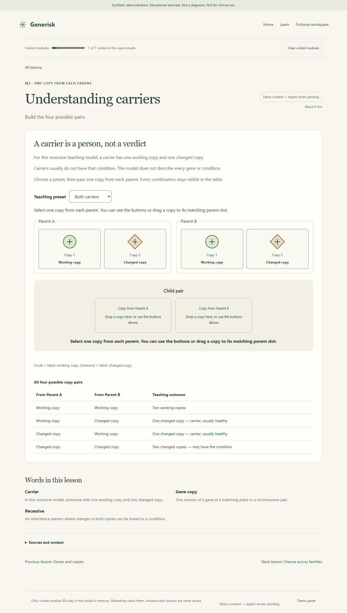
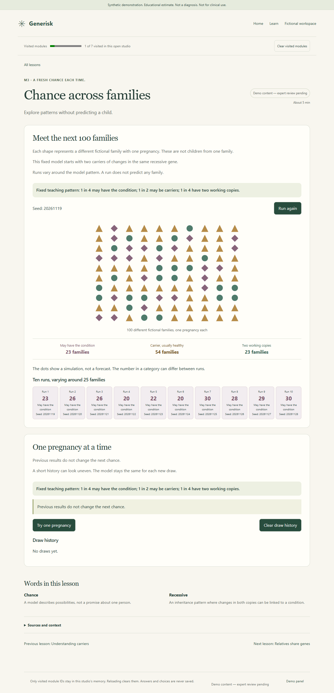
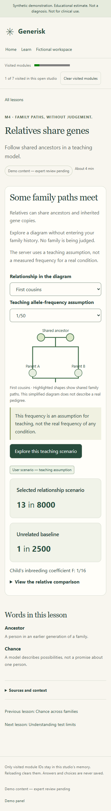

# Generisk (Amanah Genetics)

Generisk brings independent consent, traceable synthetic reports and attributed gene references into one local demonstration.

P07 adds the public [Education Studio](http://localhost:13000/learn): seven interactive English lessons and plain-language explanations of P06 outputs. [Studio guide](docs/education-studio.md); [P07 handoff](handoffs/P07-to-P08.md).

**Synthetic demonstration — not for clinical use.** People, reports, samples and laboratories are fictional; public gene/condition names are reference data. Educational calculations use the synthetic P06 model; no diagnosis or clinical interpretation is authorized.

```powershell
docker compose up --build -d --wait --wait-timeout 180
```

Open [Learn](http://localhost:13000/learn), [workspace](http://localhost:13000/workspace) or the [public demo panel](http://localhost:13000/panel). See [GENERISK_SOLUTION.md](GENERISK_SOLUTION.md) for the hackathon plan and the phase handoffs for observed delivery results.


P04 provides [fixture-only synthetic report management](docs/p04-api.md). P05 adds a [public attributed demo panel](data/public/SOURCES.md) and nine gene-level fixtures under DEC-012. In `/workspace`, grant processing, select a gene-level synthetic scenario, then grant fresh processing to view it. A/B can independently select none, CFTR or HBB carrier fixtures; uncertain/not-tested inputs require review. The predefined A none-to-CFTR correction preserves the original. Changed input invalidates old permissions/outputs. Reports remain owner-only; partners/support/fictional professionals are denied. No arbitrary upload, clinical interpretation or report RAG/AI. P06 educational estimates are separately consent-scoped. [Schema](docs/report-schema.md), [P04 evidence](docs/evidence/p04-validation.md), [P05 handoff](handoffs/P05-to-P06.md).

The reviewed P06 stack and its P05/P04/P03/P02 ancestry are merged into `main`, GitHub's default branch, by normal merge `91ce02f1b7288c35fef1892846487b3a5e20cf6f`. P07 is delivered on `feature/p07-education-studio` for review, without merging. Clinical governance stays BLOCKED; P08 requires review and separate authorization.

**Synthetic Demo — Not for Clinical Use.** P03 adds fictional local identity, independent consent, recipient-bound invitations and transactional audit to the Next.js/FastAPI/PostgreSQL foundation. No real records, genetic results, medical answers, integrations or appointments.

Current scope is [DEC-009](docs/DECISIONS.md#dec-009--hackathon-only-scope-revision-and-p02-authorization), [DEC-010 P03 authorization](docs/DECISIONS.md#dec-010--authorized-synthetic-p03-identity-and-consent) and the [hackathon milestones/engineering gates](docs/hackathon-roadmap.md). Historical clinical-production P00/full P01 remain **BLOCKED**, eight approvals **PENDING**, twelve hazards **OPEN**. An engineering PASS does not imply clinical certification, regulatory compliance or authorization for real health information.

## Learn without signing in

[Education Studio](http://localhost:13000/learn) includes copies, carriers, independent chances, shared ancestors, test limits, neutral options and fictional result explanations. Every lesson is **demo content — expert review pending**. Sources are attributed; retrieval does not establish clinical review.

Use copy buttons with a keyboard or drag them, compare seeded simulations, and explicitly request hypothetical server calculations. Only visited module IDs are kept in open-page memory; reload or clear them. No learner answers, option choices, cookies, analytics or progress API are used. The workspace retains its existing authentication, consent and stale-output checks.







All [14 desktop/mobile screenshots](docs/screenshots/) show synthetic teaching examples. [Content, language-extension and verification guide](docs/education-studio.md).

## Start the local demonstration

Requires Docker Engine/Desktop with Linux containers and Docker Compose v2. From the repository root:

```powershell
docker compose up --build -d --wait --wait-timeout 180
```

Open [the demonstration](http://localhost:13000). API [liveness](http://localhost:18000/health/live), [readiness](http://localhost:18000/health/ready) and [local API reference](http://localhost:18000/docs) are available on loopback. Host database port is 15432. No `.env` is necessary: defaults are deliberately public local placeholders; `.env.example` documents optional port overrides. Never use these credentials for real data or external hosting.

The API applies `0001_demo` then additive `0002_identity`, preserving two fictional templates and seeding four local demo accounts. Open [the identity workspace](http://localhost:13000/workspace); its public credentials section lists all logins, including `demo-a` / `demo-a-only` and `demo-b` / `demo-b-only`. Use separate browser profiles/private windows for A/B. Grant processing independently, create/copy a recipient-bound code, accept as B, then grant assessment separately. Withdraw one grant and refresh the other context: neutral unavailability appears. Assessment never grants disclosure; no reviewed output is generated. Empty knowledge and unauthorized access remain unavailable.

Review the historical [P03 handoff](handoffs/P03-to-P04.md), [evidence](docs/evidence/p03-validation.md), [API](docs/p03-api.md) and [ADR-006](docs/adr/ADR-006-demo-identity-consent.md) for identity controls; the [P07 handoff](handoffs/P07-to-P08.md) records the current delivery. Clinical-production governance stays BLOCKED.

```powershell
python scripts/smoke_stack.py
docker compose down
```

Stopping preserves the synthetic local database volume. See [local development](docs/local-development.md) for native commands and disposable migration tests, and [testing strategy](docs/testing-strategy.md) for actual verification scope.

## Repository and quality checks

`apps/web` contains the accessible frontend foundation; `services/api` the modular API, interfaces, migrations and tests; `data/synthetic` invented fixtures; `scripts` stack smoke/limited credential scanning; `.github/workflows/ci.yml` the initial CI. Root npm workspaces share a lockfile. Python runtime and verification dependencies are locked in `services/api/requirements.lock`.

With Node 22.13+ and Python 3.10+:

```powershell
npm ci
npm run lint
npm run format:check
npm run typecheck
npm test
npm run build
python -m venv .venv
.\.venv\Scripts\python.exe -m pip install -r services/api/requirements.lock
.\.venv\Scripts\python.exe -m ruff check services/api scripts/check_secrets.py scripts/smoke_stack.py tests
.\.venv\Scripts\python.exe -m mypy --config-file services/api/pyproject.toml services/api/src
.\.venv\Scripts\python.exe -m pytest -c services/api/pyproject.toml services/api/tests
python scripts/check_secrets.py
```

Without `TEST_DATABASE_URL`, PostgreSQL integration is explicitly skipped; it is not a passing database test. CI supplies a disposable `_test` database and also builds/starts Compose, runs smoke checks, and runs browser/accessibility tests. The [engineering ADR](docs/adr/ADR-005-hackathon-foundation.md) records selected boundaries and the narrowly scoped lint dependency override. Credential scanning is limited pattern detection, not a comprehensive PHI/security assessment.

## Branch and review workflow

`main` preserves the normal merge history through reviewed P06; its earlier [baseline review](docs/evidence/p02-baseline-review.md) remains historical evidence. P07 uses `feature/p07-education-studio` under DEC-014. Review the P07 handoff before authorizing a merge or P08. No force pushes, history rewriting or automatic phase advancement.

## Historical design and clinical governance

The [master roadmap](MASTER_ROADMAP.md), [P01 design handoff](handoffs/P01-design-only-review.md), [product charter](docs/product-charter.md), [intended use](docs/intended-use.md), [safety plan](docs/clinical-safety-plan.md), [regulatory assessment](docs/regulatory-applicability.md), [risk register](docs/risk-register.md) and [governance register](docs/governance-approval-register.md) remain review inputs for any future real-world service. They are not clinical approvals. DEC-009 and DEC-010 permit only their fictional hackathon implementation scopes; they close no clinical-production approval or hazard.
