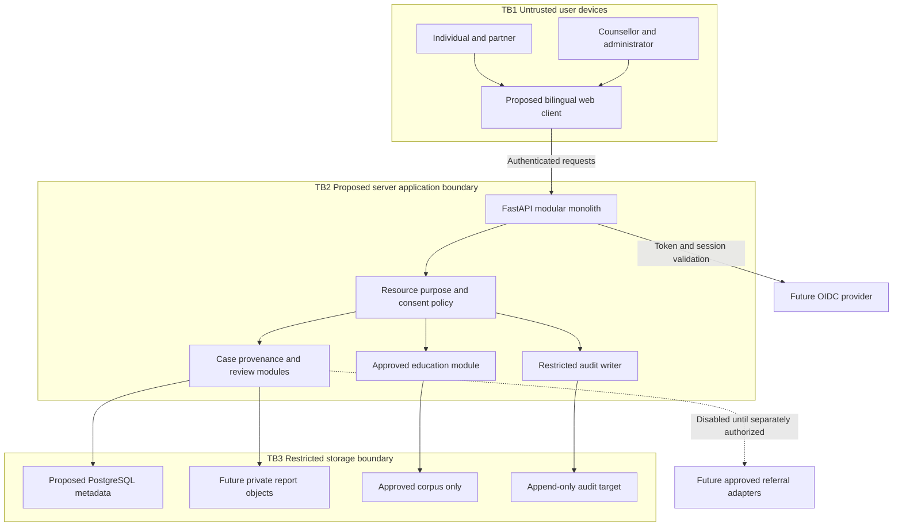

# Proposed system architecture

**DESIGN-ONLY / NOT APPROVED** | Draft 0.1 | 2026-11-15, Asia/Calcutta

Current fictional hackathon implementation: [ADR-005](adr/ADR-005-hackathon-foundation.md), [ADR-006](adr/ADR-006-demo-identity-consent.md) and [P03 API](p03-api.md) describe the implemented P02/P03 boundaries under DEC-009/DEC-010. The clinical-service proposal below remains historical and unapproved; P00/full clinical P01 stay BLOCKED.

Scope: [DEC-008 amendment v1](DECISIONS.md#dec-008-amendment-v1--restricted-documentation-activation). No service, database, identity provider or deployment is created. P00 and full P01 remain BLOCKED.

## Assumptions and dependencies

One operator is proposed but UNASSIGNED (APR-01). Disease/test scope, classification, lawful purposes, retention and hosting remain PENDING (APR-02/APR-03/APR-04/APR-05). All H01-H12 remain OPEN. Design uses fictional examples and no operational health data. External actors/components in diagrams are future roles/candidates, not connected services.

## Component and trust-boundary diagram

TB1 is never an authorization authority. TB2 must enforce current policy on every sensitive access. TB3 role/schema separation is defense in depth, not independent service isolation. Identity and any eventual external provider introduce separate supplier/location boundaries requiring approval. Detailed flows and access/retention owners are in [data flows](data-flows.md).

## Proposed modular responsibilities

| Module | Responsibility | Explicit boundary / traceability |
|---|---|---|
| Identity/session adapter | Validate issuer/audience/signature/session state; map verified future identities | OIDC candidate only; no clinical entitlement from login; APR-05, H05/H10 |
| Authorization/consent | Evaluate subject/resource/purpose, relationship, assignment, consent version and expiry/withdrawal | Central policy service within monolith; no browser-only enforcement; APR-04/APR-05, H02/H06 |
| Individual cases/provenance | Private ownership, supported input metadata, amendments and review state | No default partner/admin sharing; APR-02/APR-04, H02/H09 |
| Joint assessment/disclosure | Bind pair, purpose, input/output versions and independent grants | Assessment permission is not disclosure; recheck at write/read; APR-02/APR-04, H02/H06 |
| ClinicalRulesProvider boundary | Future deterministic, approved rules only | No implementation or selected rules; missing approval disables output; APR-02/APR-03, H01/H04 |
| Review/referral | Assigned professional review and clearly simulated referral state | No provider integration/credential assertions; APR-01/APR-07, H10/H11 |
| KnowledgeProvider boundary | Approved general education, version/language filtering and safe empty corpus | No patient store/PHI embeddings or clinical-context access; APR-02/APR-06, H05/H12 |
| Content governance | Separate drafting, bilingual clinical approval, expiry and withdrawal | Runtime must never promote draft content; APR-06, H01/H08/H12 |
| Audit/operations | Minimal sensitive-action records, integrity and restricted review | No raw findings in logs or admin dashboards; fail closed on required audit failure; APR-04/APR-05, H05 |

## Technology proposals and alternatives

Next.js/React/TypeScript and Tailwind are roadmap candidates for a bilingual accessible client; component library selection remains open. FastAPI/Pydantic are proposed for a modular monolith; no package versions or dependencies are selected here. PostgreSQL is proposed for relational consent/provenance/audit metadata; separate `app`, `clinical`, `audit` and `knowledge` schemas/roles are options to review, not migrations. pgvector is an eventual approved-corpus option, not an enabled service.

OIDC with a provider such as Keycloak is a candidate; procurement, deployment location, MFA/session/recovery policies and professional credential validation remain separate decisions. Durable workers/queues and object storage are future options only when requirements justify them. Do not treat vendor names as approved suppliers or infer authorization from architectural choice.

A modular monolith reduces early operational boundaries and coordination cost. It concentrates failure/privilege risk, requiring strict module interfaces, least-privileged data access and tested policy. Microservices are deferred until evidence justifies their additional operational and cross-service authorization burden. See [ADR-001](adr/ADR-001-modular-monolith.md).

## Authorization and consistency proposal

Identity, patient ownership and clinician role are separate facts. Each operation requires an explicit allowed purpose, current resource relationship/assignment and necessary independent grants. Default deny; identifiers never grant access. Sensitive operations recheck consent/resource/output versions inside the authoritative commit/read decision. Revocation advances a permission version, invalidates pending work and blocks subsequent joint reads. Caches cannot authorize sensitive access. A future implementation must define and test the concurrency linearization point; this design does not claim one exists.

No bulk exports, persistent sensitive browser storage, public object URLs or administrative clinical bypass are proposed for the initial scope. Required audit failure blocks sensitive commits/disclosure. Supplier outages/invalid tokens/missing review or content fail closed or safely unavailable. [Consent matrix](consent-matrix.md) and [API outline](api-outline.md) specify proposed denial behavior.

## Review gaps

Hosting/remote access, lawful processing/retention, device classification, operator/professional responsibilities and clinical scope require APR-01 to APR-05/APR-07 review. All architecture decisions are DRAFT/PROPOSED. No scalability, security, availability, legal or clinical acceptance follows from this diagram. Further reasoning is in [ADR index](adr/README.md), [threat model](threat-model.md) and [RAG architecture](rag-architecture.md).
