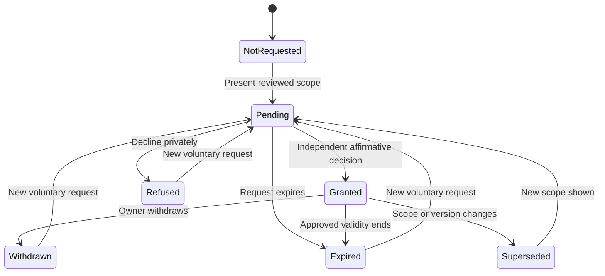

# Independent consent, permissions and withdrawal design

P04 amendment (2026-11-16, DEC-011): own current input processing is required for report content/metadata/history/import/correction. Partner/joint choices never grant raw report access. All professional/support report access defaults deny because C-PROF report purpose remains unresolved; existing case-metadata access is unchanged. Input changes invoke P03 supersession atomically, requiring fresh processing and affected assessment/disclosure choices rather than automatic carry-forward. [Provenance](report-provenance.md) records correction/withdrawal ordering and audit rollback. No APR-04 or H02/H05/H06/H09 closure or clinical consent approval.

**DESIGN-ONLY / NOT APPROVED** | Draft 0.1 | 2026-11-15, Asia/Calcutta

Fictional hackathon P03 implements a bounded subset under DEC-010; see [ADR-006](adr/ADR-006-demo-identity-consent.md) and [runtime API](p03-api.md). Processing includes assigned fictional counsellor metadata access only; this shortcut does not settle the professional-purpose choices below. No legal consent form or real-world clinical processing is approved.

Scope: [DEC-008 amendment v1](DECISIONS.md#dec-008-amendment-v1--restricted-documentation-activation). No consent service or legal consent form is implemented. P00 and full P01 remain BLOCKED.

## Assumptions and dependencies

Fictional independently participating adults only. Consent is neither authentication nor a blanket lawful basis. Operator, counsel and clinical/privacy reviewers must decide where consent is appropriate, necessary and legally sufficient, including evidence retention and access rights (APR-01/APR-02/APR-03/APR-04). All H01-H12 remain OPEN, especially H02/H03/H05/H06. Names, durations, recipients and wording are not approved.

## Proposed independent decisions

| Decision ID | Decision owner / exact scope | What it may permit | What it does not permit | Dependencies |
|---|---|---|---|---|
| C-PROC-A / C-PROC-B | Each adult separately; own specified data/purpose/version | Future authorized individual processing within scope | Partner linkage, joint assessment, research or disclosure | APR-02/APR-04; H02/H05/H06 |
| C-ASSESS-A / C-ASSESS-B | Each adult; exact counterpart, inputs/versions, purpose and assessment request | Combining the specified inputs for a defined reviewed assessment when both valid | Showing partner's raw record or releasing any joint result | APR-02/APR-04; H01/H02/H06/H09 |
| C-DISCLOSE-A / C-DISCLOSE-B | Each adult; exact reviewed output/version, named audience and purpose | A separately scoped joint-output release only after both valid and review complete | Indefinite future results, new audiences, amended outputs or raw partner reports | APR-02/APR-04; H02/H03/H06/H09 |
| C-PROF | Participant authorization/approved legal basis for a defined professional service, to be determined | Assigned qualified professional access to necessary case fields | Any clinician's access by role alone, admin access or unrestricted onward referral | APR-01/APR-03/APR-04/APR-07; H05/H10/H11 |
| C-RESEARCH | Excluded from this proposed MVP | Nothing currently | Reuse for research, training, advertising, analytics beyond approved minimized purposes | APR-03/APR-04; H05/H07 |

The two-person conjunction is a proposed safety rule for joint assessment/disclosure, not an interpretation of all legal exceptions. User-facing authorization for output V must explain the nature of joint inference without revealing V or the partner's findings before permission. Safe pre-disclosure explanations and whether additional counselling is required remain clinical/privacy-review questions. Missing approved wording blocks release.

## Proposed state transitions for each scoped decision

No refusal/withdrawal silently transitions to Granted. A fresh grant is a new version; past decisions remain evidence subject to approved retention. Invitation state is separate and never creates any C-PROC/C-ASSESS/C-DISCLOSE grant. Request expiry/validity values are PENDING under APR-04/APR-05. Notifications must not distinguish refusal from expiry to the partner.

## Proposed permission matrix

All sensitive operations additionally require authenticated identity, approved purpose, current resource relationship/assignment, supported state and minimal audit. Deny on unknown/missing state.

| Operation | Individual A | Partner B | Assigned qualified professional | Administrator |
|---|---|---|---|---|
| Read A's private record | Own-resource policy and approved processing/rights basis | Deny even when jointly participating | Only scoped assignment, verified role and approved C-PROF/basis | Deny clinical details |
| Send minimal invitation | Own invitation, no clinical payload | Independent recipient acceptance/refusal only | No silent linking | No linking on behalf of participant |
| Grant/refuse/withdraw A's choice | A only, exact scope/version | Deny | Cannot grant for A | Cannot grant for A |
| Request joint assessment | Both C-PROC and both C-ASSESS; exact pair/input versions | Same conjunction | Also assignment and permitted purpose | Deny |
| View reviewed joint output V | Both current C-DISCLOSE for V/audience plus valid underlying conditions | Same conjunction; no raw partner findings | Separate scoped professional basis; participant disclosure grants are not staff entitlement | Deny |
| Review/correct clinical case | Request correction; no self-approval of clinical claims | Own records only | Assigned qualified reviewer; preserve provenance and re-review dependent outputs | Operational routing only |
| Request referral | Own authorized request; explicitly simulated until approved | No partner request without independent basis | Scoped case/purpose and approved provider pathway | Minimized operational status only |
| Read consent history | Own choices only | No private reasons/history of counterpart | Only necessary scoped review | No clinical context; narrowly approved support fields |
| Read audit | Subject access rights process PENDING | No cross-person event feed | No unrestricted event feed | Dedicated audit-review role only; admin is insufficient |

## Withdrawal, amendments and concurrency

Proposed invariant: at the authoritative withdrawal commit, the scoped permission version advances. Every subsequent sensitive commit or disclosure must reject the withdrawn version. Queued work must recheck before processing and before result commit/release; stale results are withheld. Sensitive reads and revocations require an explicit consistency/linearization design and negative race tests before runtime approval; this document does not implement them.

Withdrawing one joint permission blocks future dependent joint processing or viewing for both participants. It does not invalidate the other person's independent private account, reveal the withdrawing person's reason or promise removal of material already lawfully viewed. Statutory retention, access rights, legally required processing and deletion of derived data/backups are unresolved counsel/privacy decisions, not automatically overridden by the UI.

Amended reports/rules or changed audiences supersede dependent output/disclosure scope. Re-review and new scoped authorization are required before later release; no broad rolling consent is assumed. If audit/consent state is unavailable, fail closed. No downloadable joint exports are proposed initially because future access cannot retract copies.

## Refusal and coercion protections

Private choice screens explain refusal and withdrawal without penalties or relationship judgement. Both adults get independent authenticated sessions; a partner cannot complete the other's consent. Shared-device notifications and histories must avoid sensitive previews. A neutral state such as unavailable for joint review must not reveal whether a person refused, expired, withdrew or has a particular finding. Counsellor access must not become a route around refusal. Coercion/unsafe sharing suspends affected disclosure and uses an approved professional pathway; that pathway is still PENDING APR-02/APR-07.

## Review gaps

No consent copy, lawful basis, retention period, inferred-information explanation, clinician exception or decision-making-capacity rule is legally/clinically approved. Minors and substitute decision-making remain excluded. Review [requirements AC-04 to AC-08](requirements.md), [UX](ux-workflows.md), [data flows F02/F03/F05](data-flows.md), [threats](threat-model.md) and [ADR-002](adr/ADR-002-consent-authorization.md). Full P01 gate remains BLOCKED.
