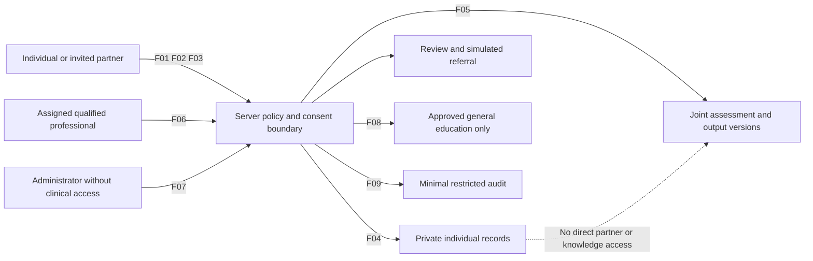

# Data inventory, conceptual flows and authorization boundaries

**DESIGN-ONLY / NOT APPROVED** | Draft 0.1 | 2026-11-15, Asia/Calcutta

Authorized by [DEC-008 amendment v1](DECISIONS.md#dec-008-amendment-v1--restricted-documentation-activation). This is a proposed inventory, not stored data or a lawful-basis finding. P00 and full P01 remain BLOCKED.

## Assumptions and dependencies

All examples (`syn-person-a`, `syn-person-b`, `syn-case-01`) are fictional identifiers without genetic findings. No real data collection is authorized. Accountable operator/data controller is UNASSIGNED (APR-01); lawful purposes, hosting/transfers and retention are PENDING (APR-03/APR-04/APR-05). Listed owners are required roles, not appointments. All H01-H12 remain OPEN.

## System context and sensitive paths

The dotted edge describes a prohibited direct path: only the policy-controlled assessment can select authorized inputs. It is not a data transfer or permission grant. TB1 user devices, TB2 server and TB3 restricted storage correspond to [architecture](architecture.md). No sensitive flow to a public LLM, embedding corpus or public analytics system is permitted.

## Proposed inventory and retention decisions

| Data ID | Category / minimum proposed content | Required accountable owner | Storage/access proposal | Retention/transfer decision and risk |
|---|---|---|---|---|
| D01 | Account identity/session references, language preference | Operator/privacy lead UNASSIGNED | Identity boundary; no findings in profile | Duration, recovery and locations PENDING APR-03/APR-04/APR-05; H05/H07 |
| D02 | Consent purpose/audience/version, decision and withdrawal evidence | Privacy lead UNASSIGNED | Restricted consent ledger; subject views own choices | Legal evidence/retention duties PENDING APR-04; H02/H06 |
| D03 | Invitation recipient reference, token digest, state; no clinical findings | Privacy/security leads UNASSIGNED | Minimal invitation service state; intended authenticated recipient only | TTL, recipient verification, deletion and abuse records PENDING APR-04/APR-05; H02/H03 |
| D04 | Future report object/source, corrected-version status, supported scope | Clinical/operator leads UNASSIGNED | Private objects and clinical metadata; case-specific authorization | All ingestion disabled in this phase; legal retention/hosting PENDING APR-02/APR-03/APR-04; H05/H09 |
| D05 | Assessment input/version references and reviewed output, no universal score | Clinical lead UNASSIGNED | Clinical boundary; explicit pair/purpose and output audience | Retention/derivation/correction obligations PENDING APR-02/APR-04; H01/H02/H04/H06 |
| D06 | Assigned review and referral status, minimal contact routing | Clinical/operator leads UNASSIGNED | Assigned staff only; simulated referral until approval | Provider disclosure fields/agreements/retention PENDING APR-04/APR-07; H10/H11 |
| D07 | Actor pseudonymous reference, action, purpose, decision, version, timestamp | Privacy/security leads UNASSIGNED | Append-only restricted audit; no raw findings, tokens or narrative | Audit retention, integrity, rights and access PENDING APR-03/APR-04/APR-05; H05/H06 |
| D08 | Educational content/source/license/language/review metadata | Clinical-content lead UNASSIGNED | Knowledge boundary; approved public/reference content only | Review/expiry/licensing schedule PENDING APR-02/APR-06; H01/H08/H12 |
| D09 | Minimized operational counters/errors without clinical payloads | Security/privacy leads UNASSIGNED | Restricted observability; no session/invitation secrets or raw questions | Suppression, purpose and retention PENDING APR-04/APR-05; H05/H07 |

No retention period, lawful basis, data residency exception or international access is approved. Withdrawal is not automatic destruction of legally retained evidence; prior lawful disclosure cannot be undone. In the absence of approved decisions, prohibit real collection rather than choose arbitrary defaults. Backups, caches, audit trails and derived outputs must be included in eventual retention/transfer review.

## Sensitive flow control matrix

| Flow | Proposed purpose and data | Proposed authorization check before use/release | Owner / unresolved decision | Traceability |
|---|---|---|---|---|
| F01 | Individual account/private case view; D01/D04 | Authenticated subject owns resource; allowed purpose; current processing grant where required | Operator/privacy UNASSIGNED; lawful basis/retention PENDING | APR-01/APR-04; H05/H07 |
| F02 | Send/accept independent invitation; D03 | Sender can invite without revealing findings; intended authenticated recipient; unused/unexpired token; no automatic case access | Privacy/security UNASSIGNED; verification/TTL/abuse policy PENDING | APR-04/APR-05; H02/H03 |
| F03 | Record grant/refusal/withdrawal; D02 | Actor controls only own decision; exact version/purpose/audience; reject replay/stale updates | Privacy UNASSIGNED; legally sufficient semantics/retention PENDING | APR-04; H02/H06 |
| F04 | Future report input/provenance; D04 | Own/assigned case and explicit purpose, source eligibility and current processing permission; no actual ingestion now | Clinical/operator UNASSIGNED; disease/input scope and agreements PENDING | APR-02/APR-03/APR-07; H09/H10 |
| F05 | Compute joint assessment then separately disclose D05 | Both current processing/assessment grants for exact pair and supported inputs; disclosure requires both independent output/audience grants plus qualified review; recheck at commit/read | Clinical/privacy UNASSIGNED; inference warnings/retention PENDING | APR-02/APR-04; H01/H02/H06/H09 |
| F06 | Professional review/referral D04/D05/D06 | Verified role plus current case assignment/purpose and permitted records; patient disclosure permissions do not automatically grant professional access or vice versa | Clinical/operator UNASSIGNED; credentials, referral basis, providers PENDING | APR-01/APR-04/APR-07; H05/H10/H11 |
| F07 | Support/admin D01/D09 | Assigned support purpose with minimized fields; no clinical/partner records or bulk export | Operator/privacy UNASSIGNED; support retention and review PENDING | APR-04/APR-05; H05 |
| F08 | Retrieve general education D08 | Approved/current/source-licensed language-version filter; no D01-D07/D09 inputs to corpus | Content/privacy UNASSIGNED; actual approved sources PENDING | APR-02/APR-04/APR-06; H01/H08/H12 |
| F09 | Audit sensitive decisions D07 | Restricted writer; minimal event; independent reviewer access; sensitive action denied if required event cannot persist | Security/privacy UNASSIGNED; audit retention/control evidence PENDING | APR-04/APR-05; H05/H06 |

Purposes above are product proposals, not approved lawful purposes. Notifications are limited to generic private-navigation prompts; no findings, refusal reasons or sensitive state in email/SMS/push. Such providers remain unselected/unconnected. Downloads, telemetry payloads and cross-border access are excluded until separately approved.

## Review gaps

Every listed flow has a proposed check, data set and required owner role, but lawful basis, named ownership and retention decisions remain unresolved. Therefore the roadmap's full P01 data-flow gate is **BLOCKED**, not satisfied by this table. [Consent matrix](consent-matrix.md), [threat model](threat-model.md), [ADR-004](adr/ADR-004-hosting-retention.md) and the [governance register](governance-approval-register.md) must be reviewed together.
