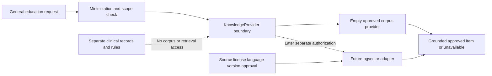

# Future approved-education retrieval architecture

**DESIGN-ONLY / NOT APPROVED** | Draft 0.1 | 2026-11-15, Asia/Calcutta

Scope: [DEC-008 amendment v1](DECISIONS.md#dec-008-amendment-v1--restricted-documentation-activation). No KnowledgeProvider implementation, embedding, vector database, model call, prompt execution or ingestion pipeline is created. P00 and full P01 remain BLOCKED.

## Assumptions and dependencies

Approved corpus is empty. No educational document, clinical rule or bilingual fallback is represented as approved. Knowledge contains approved general/reference education only, never participant reports, findings, consent records or chat histories. Source licensing, clinical/content approval, language equivalence, vendors and processing locations are PENDING APR-02/APR-03/APR-04/APR-05/APR-06. All H01-H12 remain OPEN, especially H01/H04/H05/H08/H12.

## Proposed component boundary

The dotted clinical edge denotes a prohibited access path, not a clinical-context feed. KnowledgeProvider has no clinical-store entitlement. Any eventual separately authorized runtime clinical access requires a distinct design/review; it must not silently extend this abstraction.

## Conceptual KnowledgeProvider responsibilities

| Operation concept | Proposed behavior | Safety boundary |
|---|---|---|
| Discover approved items | Return current, licensed, approved source/language versions for general concepts | No draft/rejected/expired content; no patient-based query |
| Retrieve eligible references | Filter by approved scope/language/version before returning content and source metadata | Similarity ranking is not clinical authority or a substitute for approval |
| Report availability | Distinguish internally empty, withdrawn, expired or unsupported-language corpus states | Patient-facing fallback cannot reveal private state or improvise medical knowledge |
| Preserve provenance | Return content ID/version, exact source/version and review metadata | No fabricated citations or attribution to unseen material |
| Withdraw/update | Invalidate dependent cached content/references after approval status/version changes | No serving old approval from a cache |

These are Markdown responsibilities, not executable methods, types or schemas. Initial future provider could be an empty/in-memory approved static catalogue; the application must remain safely usable for navigation when retrieval is absent. pgvector could later implement retrieval behind the same boundary only after separate authorization and evidence.

## Empty-corpus and unsupported-language behavior

The current empty corpus yields no clinical/educational answer generation. In a future interface, show a reviewed static unavailable/help message if approved; otherwise a generic service-unavailable state without medical claims. Offer a qualified-help route only after operator approval. Do not invoke a model to fill the gap, translate clinical content automatically, fabricate a source or infer personal risk. A model provider outage cannot convert abstention into free-form completion.

Requested language must have approved equivalent content. A user may intentionally choose an available approved language; there is no silent cross-language substitution that changes consent comprehension. Knowledge availability is separate from any person's results and must not reveal partner state (H02/H08).

## Proposed source and approval metadata

Each item needs source URL/title/edition/date, author/publisher, license/permission, source provenance/hash, content ID/version, language/translation lineage, intended audience/scope, clinical reviewer/role/date, approval status, review/expiry date, withdrawal reason and supersession chain. Names/approval evidence are PENDING; no values are invented.

Separate source acquisition, drafting/chunking, translation, qualified review and publication. Rejected, unlicensed, withdrawn or stale content cannot enter the serving corpus. Changes to source/chunk/model/embedding/language require impact review and regression evidence. No personal/genetic data, identifiers or participant-derived material in chunks, embeddings, prompts, evaluation logs or public issues. Free-text education requests are potentially sensitive and require minimization/approved handling; arbitrary raw questions must not be logged or sent to an unapproved provider.

## Eventual pgvector and model considerations

Future pgvector would be a retrieval mechanism within an approved location/role boundary, not a source of clinical truth. Persist approved reference metadata and approval filters alongside vectors; restrict ingestion/serving roles and prevent user uploads from becoming knowledge. Dimensions, embedding model, language evaluation, ranking, chunk sizes, retention, vendor and region are unresolved, not selected settings.

Any eventual LLM must remain an education presentation layer governed by approved sources/output constraints, with no diagnosis, pathogenicity prediction, unsupported probability, marriage recommendation, reproductive directive or ability to override deterministic reviewed rules. Retrieved instructions are untrusted data. No arbitrary tool execution or clinical-data access follows from retrieval. [ADR-003](adr/ADR-003-knowledge-clinical-separation.md) records the proposed separation.

## Future evaluation plan and review gaps

Require approved-source relevance and exact citation checks, Arabic/English equivalence, empty/withdrawn/expired-source and unavailable-provider cases, malicious-source/prompt injection, corpus poisoning, unauthorized patient-context access, cross-person inference and unsupported clinical requests. Qualified reviewers must set thresholds/dataset expectations before running an evaluation. No RAG/model evaluation, embedding test or clinical safety validation was executed here; only document/diagram checks are allowed. See [threats T10/T12](threat-model.md), [accessibility/localization](accessibility-localization.md) and [governance](governance-approval-register.md). Full P01 remains BLOCKED.
