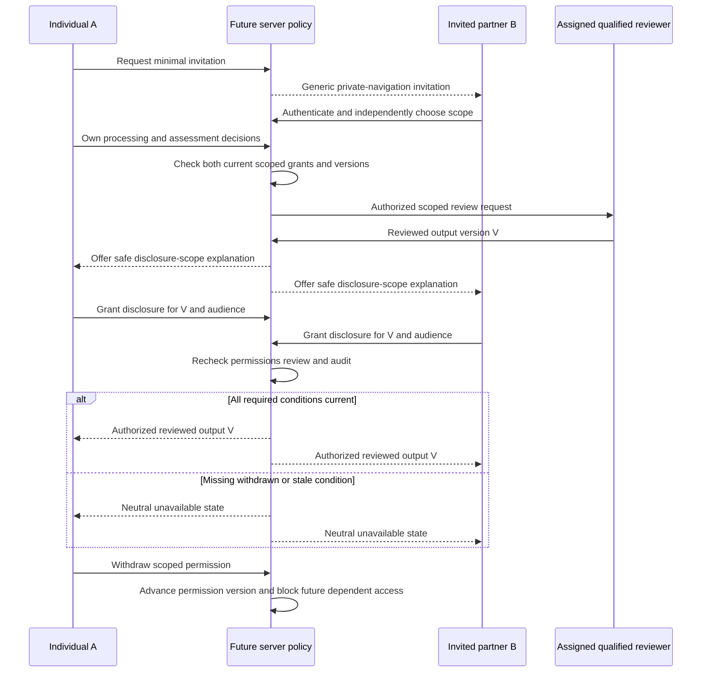

# Proposed individual, partner, counsellor and administrator journeys

**DESIGN-ONLY / NOT APPROVED** | Draft 0.1 | 2026-11-15, Asia/Calcutta

Scope: [DEC-008 amendment v1](DECISIONS.md#dec-008-amendment-v1--restricted-documentation-activation). Textual workflows/static diagram only; no UI, approved patient copy or live service. P00 and full P01 remain BLOCKED.

## Assumptions and dependencies

Fictional independent adults `syn-person-a` and `syn-person-b`; language choice does not change permissions. Clinical content, consent copy, providers, escalation, lawful purposes and professional credentials require APR-01/APR-02/APR-03/APR-04/APR-06/APR-07. All H01-H12 remain OPEN. Each journey follows [requirements](requirements.md), [consent decisions](consent-matrix.md) and [accessible interaction proposals](accessibility-localization.md).

## Individual journey

1. Choose Arabic or English and accessibility preferences before sensitive interaction. Show conspicuous synthetic demonstration/non-clinical labeling in any eventual prototype. Missing reviewed language content yields safe unavailable navigation, not automatic translation (H01/H08/H12).
2. Read scope, risk-is-not-diagnosis boundary, privacy choices and professional-help limits. No real upload or numerical assessment exists in this design phase. In a later authorized service, individual processing needs the approved basis and own explicit scope; no default partner sharing (H02/H04/H05).
3. View own permitted case/provenance/status. Unsupported or amended material becomes needs review, without inferred clinical conclusions. Correction requests do not allow self-approval of findings (H01/H09).
4. Choose whether to send a minimal invitation. Explain that refusal is allowed and no relationship judgement follows. Do not expose findings in an invitation/notification (H02/H03).
5. Independently decide joint assessment and, later, exact reviewed-output disclosure as separate choices. Explain possible joint inference in reviewed language before each relevant decision. No result appears until every required condition is met (H02/H06).
6. Withdraw future scoped permission in a private, accessible path. Confirm the effect on future access, retain legally required evidence only under approved policy, and do not promise to erase already viewed material. Own private account remains separate (H06).

## Invited partner journey

The invitation contains only approved minimal context, no report/diagnosis or refusal disclosure. Authenticate the intended recipient and validate an unused/unexpired invitation before any link is established. A forwarded/replayed token cannot grant access. The invited adult reads the same independent choices in their own language and may refuse, let the request expire or withdraw without a clinical/relationship penalty.

The other participant sees a neutral unavailable-for-joint-review state whenever the conjunction of required permissions/review/version conditions fails; it does not identify the private reason or expose a partner's record. Neither participant receives permission to act for the other. Re-invitation frequency/abuse controls, recipient verification and exact safe notification wording remain PENDING APR-04/APR-05/APR-06 (H02/H03/H06/H08).

## Joint review and withdrawal sequence

This is a future interaction proposal, not consent evidence or actual clinical workflow. Qualification, review/disclosure wording and recheck/audit semantics require human approval; no output is generated now.

## Counsellor journey

Authenticate using an approved strong staff method; role alone does not populate a clinical queue. Only currently assigned, purpose-authorized cases appear. Inspect eligible input/source/version and permitted individual/joint scope, document uncertainty and stop on unsupported/amended data. No autonomous clinical interpretation or universal genetic matching is proposed.

Submit a review with attributable version/provenance, preserving corrections. Clinical review does not itself release output to participants: the separate disclosure gate still applies. Requests for referral remain simulated unless provider agreements, patient authorization/basis and verified appointment evidence exist. Ambiguous/high-impact/coercive situations use an approved escalation pathway; that pathway/coverage and professional appointments remain PENDING (APR-01/APR-02/APR-04/APR-07; H01/H02/H09/H10/H11).

## Administrator journey

Authenticate into a separate support purpose. View only minimized account/operational information and generic error routing; do not expose case filenames, genetic findings, consent refusal reasons or partner relationships by default. Cannot grant consent, impersonate a participant, approve clinical output or assign oneself broad clinical access. Role provisioning/assignment changes require an approved review process and audit, still PENDING APR-04/APR-05 (H02/H05/H10).

Audit review is a distinct narrow privilege, not a feature of every administrator. Incident escalation must avoid copying health data into tickets/logs. No bulk export, real provider provisioning or operational dashboard is implemented.

## Error, recovery and escalation journeys

Invalid/expired invitation: offer safe restart/help without revealing recipient/case existence. Authorization or consent failure: deny payload and show neutral state to the partner; explain one's own choices privately. Missing content: reviewed fallback/unavailable status. Stale/corrected report: needs review and no old result. Dependency/audit failure: unavailable, no sensitive success acknowledgement. Session expiry: clear sensitive display and require authentication; recovery must not bypass identity/consent.

Do not claim emergency coverage, booked appointments or fixed response times. Approved local help/urgent pathways must be supplied by the operator/clinical lead before any real service. Notifications and shared-device histories must avoid previews and unnecessary disclosure (H05/H06/H08/H11).

## Review gaps

No participant validation, Arabic/English comprehension, accessibility audit, professional walkthrough or clinical escalation drill has occurred. Safe consent/disclosure copy and neutral status wording are draft concepts only. These journeys cannot satisfy full P01's reviewer-validation gate; it remains BLOCKED. Review [threats T07/T08/T14](threat-model.md) and [API semantics](api-outline.md) alongside these flows.
